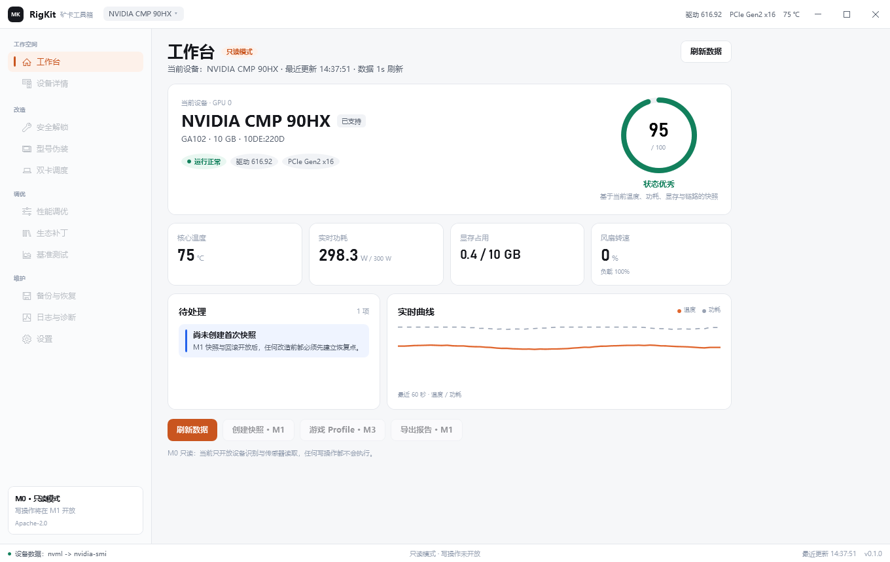

# 矿卡工具箱 RigKit

[](https://github.com/1922708082/rigkit/actions/workflows/ci.yml)

仓库：<https://github.com/1922708082/rigkit>

面向矿卡持有者的硬件全生命周期工作台：验卡、解锁、调优、维护，全程可回滚。



> 截图由 `--smoke` 无头渲染生成，曲线为演示数据填充；真实运行时为 1 秒实时采样。

## 当前状态

设计已确认，M0 开发中。.NET 10 SDK 10.0.402 已安装，WPF 模板可用。

M0 已完成：

- `RigKit.slnx` + 8 个主项目 + `tools/RigKit.Probe`
- `Directory.Build.props` / `global.json` / `.editorconfig`
- Domain 设备与传感器模型、`IDeviceProvider` 抽象
- `NvmlProvider`（首选）+ `NvidiaSmiProvider`（回退）+ `FallbackDeviceProvider`
- 本机 CMP 90HX 实测通过：PCIe Gen2 x16、10 GB、驱动 616.92、温度 / 功耗 / 频率可读
- Broker 只读管道：`system.info` / `ping`，`CurrentUserOnly`，单实例信号量
- WPF 工作台：1360×860、侧栏、设备卡、评分环、4 个 KPI、风险列表、1 秒曲线
- `--smoke` 无头渲染，用于 UI 回归与截图
- `SupportMatrix`：CMP 默认 Supported，P 系列与 170HX 统一 Experimental，P 系列禁用图形解锁入口
- xUnit 单元测试 19 个用例通过（CSV、缺失值、支持级别、Provider 回退）
- `LICENSE`（Apache-2.0）与 `NOTICE` 已加入仓库
- GitHub Actions CI：restore / build / test

M0 待办：PnP 热插拔、300 点环形缓冲 + SQLite 降采样、单实例、审计表、崩溃 dump。

## 开发命令

```powershell
# 构建（脚本内部使用用户级 .NET 10 SDK 绝对路径）
.\build.ps1

# 设备探测（只读，不需要管理员权限）
.\probe.ps1

# 无头渲染工作台截图（UI 回归）
dotnet run --project src\RigKit.App -- --smoke .\docs\screenshots\home-m0.png
```

SDK 建议装在 `%USERPROFILE%\.dotnet`（10.0.402）。系统自带的 `C:\Program Files\dotnet` 如果只有运行时、没有 SDK，`dotnet` 命令可能命中旧宿主；可在 PowerShell profile 中转发到用户级 SDK，或直接运行 `.\build.ps1`。

## 首版范围

- NVIDIA CMP：30HX / 40HX / 50HX / 70HX / 90HX / 170HX
- Pascal 矿卡：P102-100 / P104-100 / P106-100 / P106-090

P 系列统一标记 **实验性（Experimental）**，不做“图形解锁”承诺，以体检、功耗、计算 Profile、驱动诊断为主；即使体检全绿也不升为 Supported。

## 文档

| 文件 | 内容 |
|---|---|
| `docs/DESIGN.md` | 完整产品设计方案：现状分析、产品定位、架构选型、模块与数据流、界面规范、打包发布、风险与实施计划 |
| `docs/TASK.md` | 勾选式任务清单，按 M0~M4 里程碑拆解，含依赖与验收口径 |
| `docs/design-preview.html` | 可视化评审稿：架构图、工作台设计稿、组件与发布链路 |

## 一句话结论

不沿用现有单进程管理员架构，改为 **.NET 10 + WPF + 独立提权 Broker + 规则包驱动**；复用 HX 工具箱已验证的底层能力，但作为独立新版本开发，不迁移旧配置、不做兼容层。

签名走开源路线：Certum Open Source 为主，Sigstore 透明签名为辅，并行申请 SignPath Foundation。

## 开源协议

本项目采用 **Apache License 2.0**，全文见 `LICENSE`，版权与归属说明见 `NOTICE`。第三方组件遵循各自许可，发布时会一并附上。

## 阅读顺序

1. 先用浏览器打开 `docs/design-preview.html` 看整体方案与界面稿。
2. 再看 `docs/DESIGN.md` 第 1 章（现状诊断）与第 3 章（架构选型）。
3. 已确认决策见 `DESIGN.md` 9.1，剩余非阻塞项见 9.2；开发按 `docs/TASK.md` 推进。
